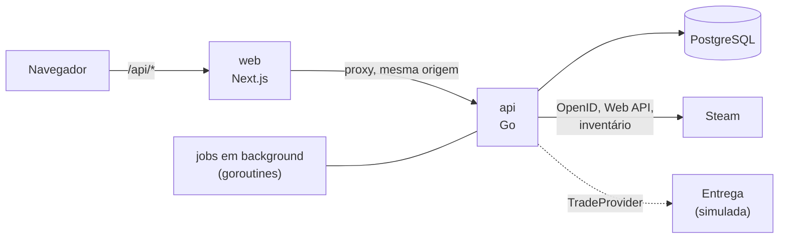
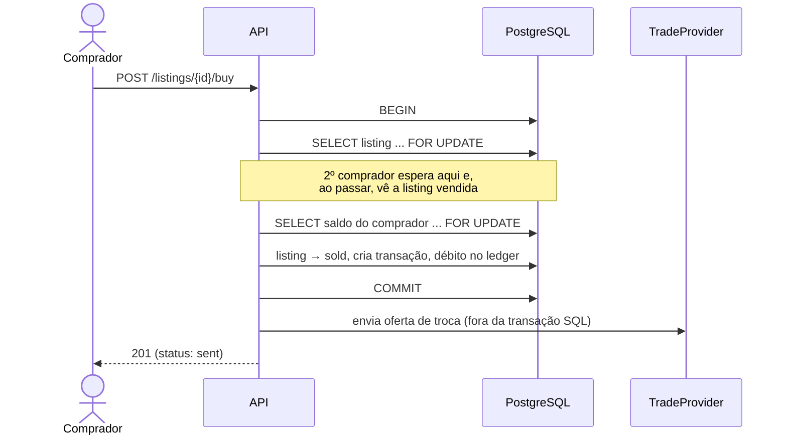
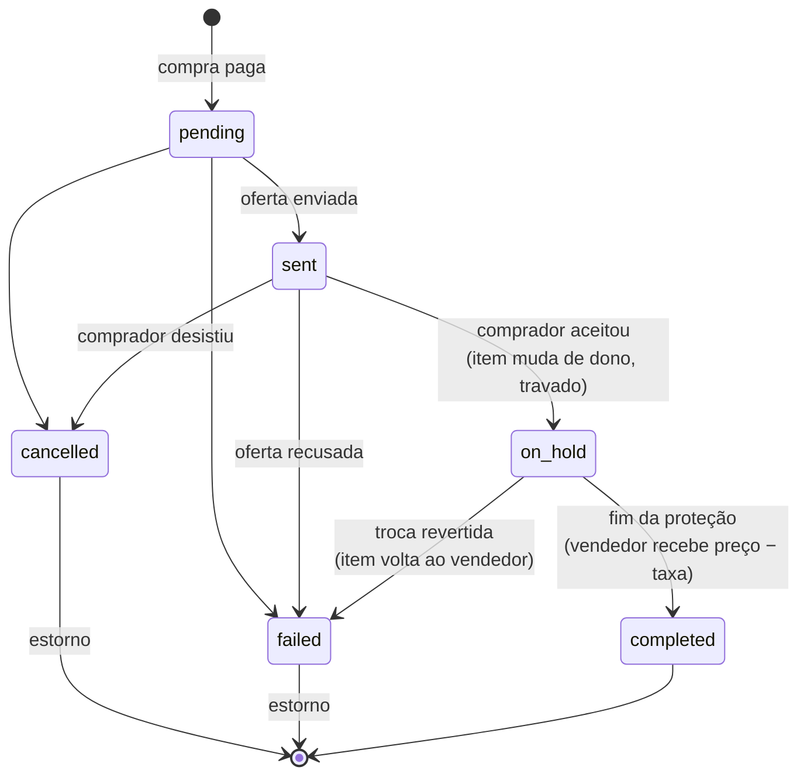

# ViceSkins

Marketplace de skins de **Counter-Strike 2**, no estilo CSFloat/Skinport. O usuário entra com a Steam, importa o inventário, anuncia skins e compra de outros jogadores com saldo na plataforma.

Projeto de portfólio com foco no backend: **Go**, **PostgreSQL** e as partes difíceis de um marketplace — compra concorrente sem venda dupla, dinheiro auditável e uma máquina de estados para a entrega.

> Não afiliado à Valve. A entrega dos itens é **simulada**: nenhuma troca real acontece na Steam.

---

## Funcionalidades

- **Login com Steam** (OpenID 2.0) e sessão em cookie `httpOnly`
- **Inventário de CS2** importado da Steam, com float, pattern, stickers e chaveiros, em cache com cooldown
- **Anúncios**: criar e cancelar, com validação de dono, item negociável e preço
- **Mercado público** com busca por nome, faixa de preço, desgaste (FN–BS), faixa de float, ordenação e paginação
- **Carteira** com depósito simulado e extrato; o saldo é um ledger auditável. O valor das vendas fica **bloqueado** até o fim da proteção de troca da Steam
- **Trade URL** obrigatória para comprar e anunciar, validada contra a conta Steam do usuário
- **Compra atômica**: dois compradores no mesmo item ao mesmo tempo → exatamente um leva
- **Entrega simulada** com máquina de estados `pending → sent → on_hold → completed`, estorno automático em falhas e pagamento ao vendedor só depois da proteção de troca
- **Prazos** por etapa: vendedor que não envia ou comprador que não aceita a tempo → compra cancelada e estornada
- **Histórico** de compras e vendas com resumo e acompanhamento ao vivo
- **Modo demonstração**: seed com usuários e anúncios, e login sem Steam para testar tudo localmente

## Stack

| Camada | Tecnologias |
|---|---|
| API | Go 1.27, [chi](https://github.com/go-chi/chi), [pgx](https://github.com/jackc/pgx), [sqlc](https://sqlc.dev), [golang-migrate](https://github.com/golang-migrate/migrate), JWT |
| Banco | PostgreSQL 17 (`pg_trgm` para busca) |
| Front | Next.js 16 (App Router), React 19, TypeScript, Tailwind CSS 4, TanStack Query |
| Testes | `testing` + [testcontainers-go](https://golang.testcontainers.org/) (Postgres real) |
| Infra | Docker e Docker Compose |

## Arquitetura



- O **front não tem regra de negócio** e nunca fala com a API diretamente: o Next faz proxy de `/api/*`. Front e API ficam na mesma origem, sem CORS, e o cookie de sessão `httpOnly` segue sozinho, sem o JavaScript ver o token.
- A API segue **handler → service → repository**:
  - `handler` cuida de HTTP (JSON, status, cookies);
  - `service` tem as regras;
  - `repository` é o SQL tipado gerado pelo sqlc.
- As **dependências são montadas à mão** no `main.go`, sem container de injeção, e cada camada depende de **interfaces pequenas declaradas por quem as usa**. Isso deixa os testes com fakes triviais.
- **Jobs** (ofertas aceitas, fim da proteção de troca) rodam como goroutines com `time.Ticker` no mesmo processo e terminam a rodada atual antes do shutdown.

## A compra



Toda mudança de status passa por uma única função, que trava a transação, valida a transição e aplica os efeitos dela:



## Decisões técnicas

**Dinheiro**
- Sempre em centavos (`int64`/`BIGINT`), nunca em float, inclusive no front: `"15,50"` vira `1550` direto do texto.
- A taxa da plataforma é configurável em *basis points* (200 = 2%), calculada só com inteiros.

**Saldo auditável**
- Toda movimentação é uma linha imutável em `wallet_entries`, com o saldo resultante.
- `users.balance_cents` é um cache de leitura, sempre atualizado na mesma transação. A invariante `saldo = soma do ledger` é verificada nos testes.

**Concorrência e defesa em camadas**
- A compra trava a listing e o saldo com `SELECT ... FOR UPDATE`, sempre nessa ordem, para evitar deadlock.
- O banco é a última barreira:
  - `UNIQUE(listing_id)` em `transactions`;
  - índice único parcial "uma listing ativa por item";
  - `CHECK (balance_cents >= 0)`;
  - `CHECK (buyer_id <> seller_id)`.
- A chamada à Steam fica **fora** da transação SQL: nunca se segura lock do banco esperando I/O externo.
- **Outbox transacional** para o envio da oferta:
  - o pedido de envio é gravado no mesmo `COMMIT` da compra, então a API cair logo depois não perde a entrega;
  - um job reserva cada linha com `FOR UPDATE SKIP LOCKED` e um *lease* com prazo. Dois workers nunca enviam a mesma oferta, e se um morrer no meio, outro retoma quando o lease vence;
  - falhas temporárias são tentadas de novo com backoff exponencial. Falhas permanentes, ou tentativas esgotadas, viram `failed` com estorno.
- Cancelar uma compra com a oferta já enviada **cancela a oferta antes de estornar**: se o cancelamento falhar, nada é devolvido. Assim o comprador não fica com o item e o dinheiro ao mesmo tempo.

**Estados**
- A máquina de estados é um mapa único no domínio.
- O `UPDATE` de status inclui `WHERE status = <anterior>`: dois workers concluindo a mesma transação pagam o vendedor uma vez só.

**Proteção de troca e P2P**
- O vendedor só recebe quando a proteção de troca (7 dias) acaba: até lá a troca pode ser revertida, e o valor aparece como **bloqueado** na carteira, fora do saldo e do ledger. Se a troca for revertida, o comprador é estornado sem precisar tirar dinheiro de ninguém.
- A trade URL do comprador é **copiada na compra**: trocá-la depois (ex.: conta invadida) não desvia uma entrega em andamento. Só o vendedor a vê, e só enquanto precisa enviar a oferta.
- Prazos expirados também cancelam a oferta na Steam antes do estorno.

**Steam**
- O inventário fica em cache no banco, e o refresh tem cooldown reservado de forma atômica (`UPDATE ... WHERE refresh_at < cutoff`).
- O login valida a asserção OpenID com a própria Steam (`check_authentication`) e usa um `state` contra login CSRF.
- A API key nunca aparece em log.

**Busca e paginação**
- A busca por nome usa índice trigram.
- O mercado usa `limit + 1` em vez de `COUNT(*)`.
- O histórico usa **paginação por cursor**: transações novas não fazem itens repetirem entre páginas.

## Como rodar

**Pré-requisito:** Docker com Docker Compose.

### Modo demonstração (sem conta Steam)

```bash
git clone https://github.com/Eduardo-Mourao0/ViceSkins.git
cd ViceSkins
docker compose up -d --build     # postgres, migrations, api e web
docker compose run --rm seed     # usuários, itens e anúncios de demonstração
```

Abra **http://localhost:3000** e clique em **Entrar como demo**.

| Conta | Saldo | Papel |
|---|---|---|
| Ocean Buyer | R$ 5.000,00 | comprador: use para comprar |
| Neon Trader | R$ 250,00 | vendedor, com anúncios ativos |
| Sunset Collector | R$ 120,00 | vendedor, com anúncios ativos |

Para ver o ciclo da compra inteiro sem esperar 7 dias, encurte a proteção de troca:

```bash
TRADE_HOLD_DURATION=1m docker compose up -d api
```

### Com a Steam

1. Gere uma Web API key em https://steamcommunity.com/dev/apikey (domínio: `localhost`).
2. `cp .env.example .env` e preencha `STEAM_API_KEY`.
3. `docker compose up -d --build`, e use **Entrar com Steam**. O inventário precisa estar público.

### Configuração

| Variável | Padrão | Descrição |
|---|---|---|
| `STEAM_API_KEY` | — | Necessária só para o login real com a Steam |
| `JWT_SECRET` | valor de dev | Assinatura da sessão (mínimo 32 caracteres) |
| `DEV_LOGIN` | `true` no compose | Login sem Steam nas contas demo. A API se recusa a subir se ligado junto com `COOKIE_SECURE=true` |
| `PLATFORM_FEE_BPS` | `200` | Taxa da plataforma (200 = 2%) |
| `TRADE_HOLD_DURATION` | `168h` | Proteção de troca antes de pagar o vendedor |
| `SIM_TRADE_ACCEPT_AFTER` | `15s` | Simulação: tempo até a oferta ser "aceita" |
| `SELLER_SEND_TIMEOUT` | `12h` | Prazo do vendedor para enviar a oferta; depois, a compra falha e o comprador é estornado |
| `BUYER_ACCEPT_TIMEOUT` | `12h` | Prazo do comprador para aceitar a oferta; mesma regra |

## Testes

```bash
cd api
go test ./...           # tudo, inclusive integração (sobe um Postgres via Docker)
go test -short ./...    # só unitários, sem Docker
```

Os testes de integração rodam contra **PostgreSQL real** (testcontainers) e cobrem:

- 15 rodadas de **20 compradores simultâneos** na mesma listing → sempre exatamente 1 vence, e os outros não são cobrados
- o mesmo comprador fazendo compras simultâneas além do saldo → só as que cabem passam
- **10 workers concluindo a mesma transação** → o vendedor é pago uma única vez
- **job de prazos e aceite da oferta disputando a mesma transação** → só um vence, e o resultado é coerente (item entregue sem estorno, ou estorno com o item de volta)
- **10 workers despachando o outbox** ao mesmo tempo → a oferta sai uma vez só; lease vencido é retomado; retry com backoff e desistência com estorno
- 50 depósitos simultâneos → nenhuma atualização de saldo perdida
- o ciclo completo, estornos, reversão durante a proteção e transições inválidas
- todos os pares (de → para) da máquina de estados
- paginação por cursor estável com dados novos chegando entre páginas

O teste de concorrência da compra foi validado com **mutação**. Com o `FOR UPDATE` removido de propósito, ele falha em todas as execuções. A versão inicial, com uma rodada só, pegava o bug apenas às vezes.

## API

| Método | Rota | Auth | Descrição |
|---|---|---|---|
| `GET` | `/auth/steam/login` · `/auth/steam/callback` | | Login com Steam |
| `POST` | `/auth/logout` | | Encerra a sessão |
| `GET` | `/me` | ✓ | Usuário logado |
| `PUT` | `/me/trade-url` | ✓ | Cadastra a trade URL (validada: precisa ser da própria conta Steam) |
| `GET` | `/me/inventory` · `POST /me/inventory/refresh` | ✓ | Inventário em cache · sincronizar com a Steam |
| `GET` | `/listings` | | Mercado: `q`, `minPrice`, `maxPrice`, `wear`, `minFloat`, `maxFloat`, `sort`, `page` |
| `GET` | `/listings/{id}` | | Detalhe do anúncio |
| `POST` | `/listings` · `/listings/{id}/cancel` | ✓ | Anunciar · cancelar anúncio |
| `GET` | `/me/listings` | ✓ | Meus anúncios |
| `POST` | `/listings/{id}/buy` | ✓ | Comprar |
| `GET` | `/me/transactions` · `/me/transactions/summary` | ✓ | Histórico (`role`, `status`, `before`) · resumo |
| `GET` | `/transactions/{id}` · `POST /transactions/{id}/cancel` | ✓ | Detalhe · cancelar compra |
| `GET` | `/me/wallet` · `POST /wallet/deposits` | ✓ | Saldo e extrato · depósito simulado |

## Estrutura

```
api/
├── cmd/api/            main.go: configuração, montagem das dependências, servidor e jobs
├── db/migrations/      golang-migrate
├── db/queries/         SQL do sqlc
├── db/seed/            dados de demonstração
└── internal/
    ├── domain/         tipos, regras puras, máquina de estados, erros
    ├── service/        regras de negócio (compra, carteira, inventário...)
    ├── repository/     código gerado pelo sqlc + transações
    ├── handler/        HTTP (chi), DTOs, middleware de autenticação
    ├── steam/          OpenID, Web API e inventário
    ├── trade/          TradeProvider simulado
    ├── jobs/           tarefas periódicas
    └── testdb/         Postgres descartável para testes
web/                    Next.js (App Router)
```

## Limitações e próximos passos

- **Entrega real:** trocar a implementação simulada do `TradeProvider` por um serviço com `steam-tradeoffer-manager`. Com a simulação, o próximo sync de inventário pode "desfazer" uma troca, já que ela não aconteceu na Steam.
- **Depósitos reais:** integrar um gateway de pagamento e chaves de idempotência.
- **Revogação de sessão:** hoje o JWT vale até expirar; sessões no banco permitiriam logout em todos os dispositivos.
- **Preços de referência:** job buscando preços de mercado para sugerir o valor do anúncio.
- **CI:** rodar os testes de integração no GitHub Actions.
